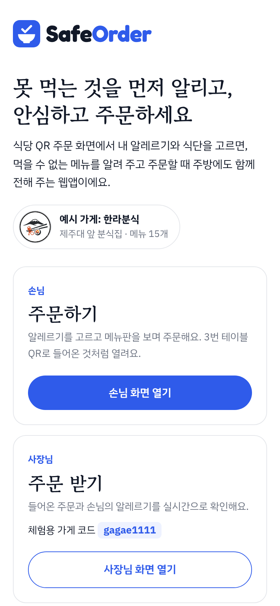
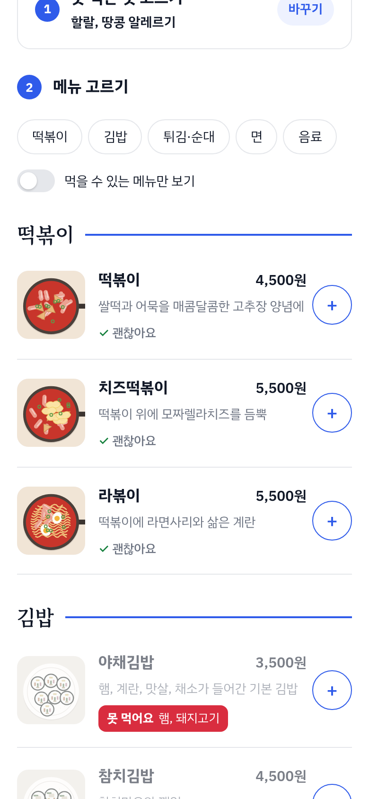
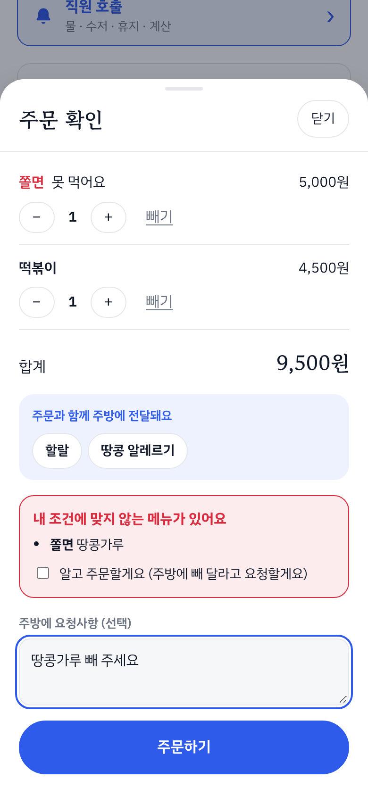
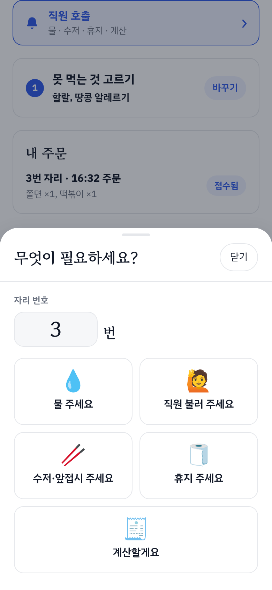
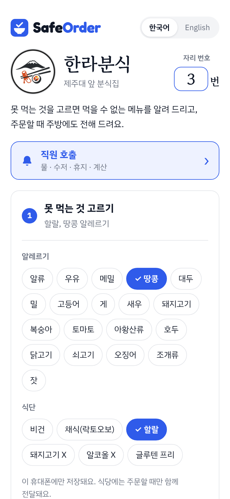
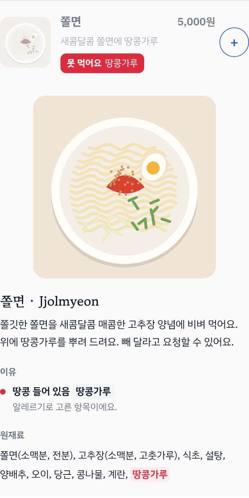
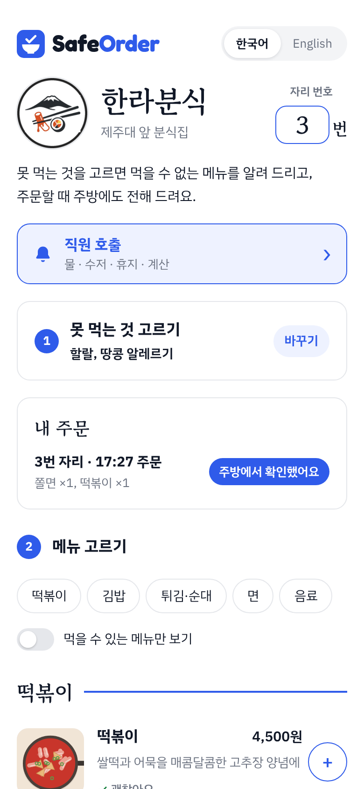
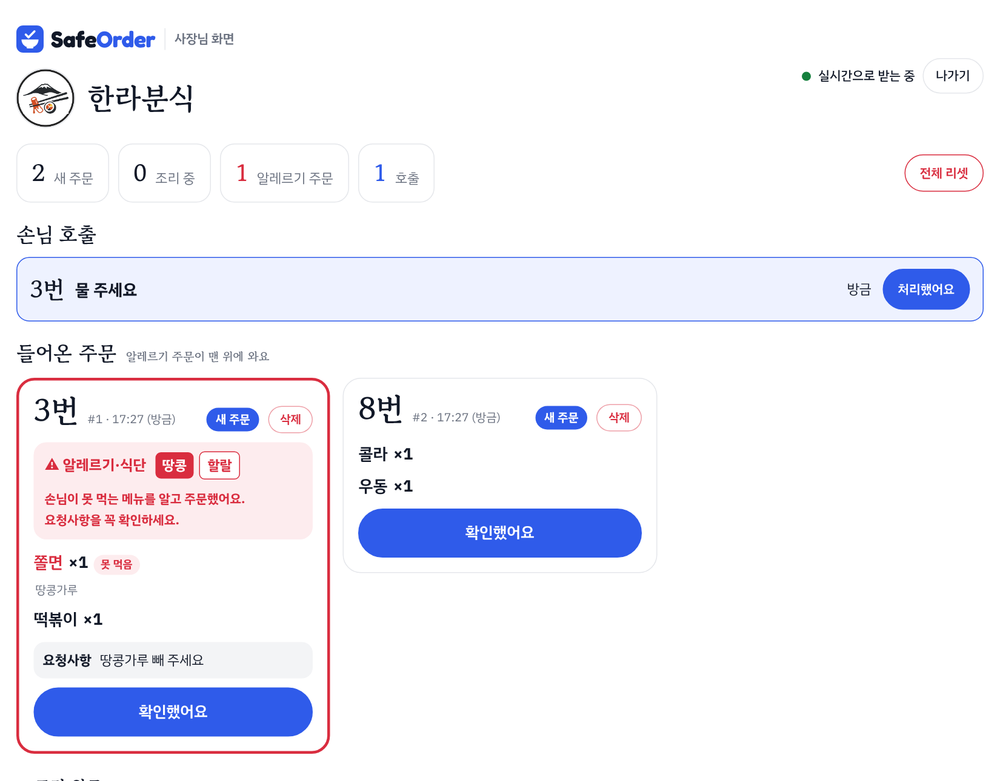

# SafeOrder

> 식당 QR 주문 화면에서 내 알레르기·식단을 미리 골라 두면, **못 먹는 메뉴를 표시해 주고**, 주문할 때 **알레르기 정보가 사장님 화면에 함께 전달되는** 웹앱

<p>




</p>

| 바로 체험하기 | 주소 |
|---|---|
| **처음 화면** (손님 / 사장님 고르기) | https://gpflsdla.github.io/ingong-project/ |
| 손님 화면 (3번 자리 QR로 들어온 것처럼) | https://gpflsdla.github.io/ingong-project/order.html?table=3 |
| 사장님 화면 | https://gpflsdla.github.io/ingong-project/owner.html |
| 체험용 가게 코드 | **`gagae1111`** (과제 시연용으로 공개, 주문은 24시간 뒤 자동 삭제) |
| 판정 테스트 페이지 | https://gpflsdla.github.io/ingong-project/tests/ |

- 과목: 인공지능 프로그래밍 중간고사 과제 (바이브 코딩)
- 만든 사람: 정혜린
- 실행 환경: 웹 브라우저 (휴대폰, 노트북). 설치 없이 위 주소를 열면 됩니다.

---

## 1. 제작한 것 소개

### 왜 만들었나

평소 외국의 알레르기 관련 이슈를 많이 보면서, 말이 통하지 않는 곳에서 음식을 먹는 사람에게 "이거 먹어도 되나?"는 정말 큰 문제라고 생각했습니다.
요즘 식당은 테이블의 QR 코드로 휴대폰에서 주문하는 곳이 많은데, 메뉴판에는 원재료가 잘 보이지 않고, 알레르기는 요청사항 칸에 손님이 직접 적거나 직원에게 말로 전해야 합니다. 바쁜 주방에서는 이 말이 빠지기 쉽습니다.

그래서 **손님은 못 먹는 것을 한 번만 고르고, 앱이 메뉴마다 먹을 수 있는지 알려 주고, 주문할 때 그 정보가 자동으로 주방에 붙어 가는** 주문 화면을 만들었습니다.

> 처음에는 식품 포장지 사진에서 원재료명을 읽어 판정하는 **LabelLens Korea**로 시작했습니다. 판정은 잘 됐지만 실제 포장 사진의 글자 인식이 끝까지 불안정해서, 원재료 정보가 처음부터 정확한 **식당 메뉴**로 방향을 바꿨습니다. ([PRD 0-1](docs/PRD.md), [3. 변경 내역](#3-todo-리스트-변경-내역))

### 무엇을 하나

| 누가 | 하는 일 |
|---|---|
| 손님 | 자리 번호 입력(QR이면 자동) → **① 못 먹는 것 고르기** (알레르기 19가지, 식단 6가지) → **② 메뉴 고르기** (메뉴마다 못 먹어요 / 확인 필요 / 괜찮아요) → 주문 → 내 주문 상태 확인. 필요하면 **직원 호출** (물, 직원, 수저·앞접시, 휴지, 계산) |
| 사장님 | 가게 코드로 들어가기 → 주문이 몇 초 안에 뜸, **알레르기 주문은 빨간 테두리로 맨 위**, 못 먹는 메뉴와 걸린 원재료까지 표시 → 확인했어요 → 조리 완료. 손님 호출 처리, 주문 삭제, 전체 리셋 |

### 화면

| ① 못 먹는 것 고르기 | ② 메뉴판과 판정 | 메뉴 자세히 보기 | 주문 확인과 경고 |
|---|---|---|---|
|  |  |  |  |
| 알레르기·식단을 고르면 이 휴대폰에만 저장 | 땅콩·할랄을 고르면 햄이 든 김밥은 빨간 "못 먹어요" | 음식 그림, 소개, 걸린 이유, 원재료 강조 | 못 먹는 메뉴를 담으면 체크해야 주문 가능 |

| 직원 호출 | 내 주문 상태 | 사장님 화면 |
|---|---|---|
|  |  |  |
| 키오스크처럼 큰 버튼, 같은 요청은 1분 잠금 | 접수됨 → 주방에서 확인했어요 → 조리 완료! | 알레르기 주문이 맨 위, 손님 호출, 삭제·전체 리셋 |

### 체험 방법 (평가하시는 분께)

1. [처음 화면](https://gpflsdla.github.io/ingong-project/)을 창 두 개(또는 휴대폰과 노트북)에서 엽니다.
2. 한쪽은 **사장님 주문 받기** → "체험용 코드로 들어가기"(코드 `gagae1111`)를 누릅니다.
3. 다른 쪽은 **손님 주문하기** → 알레르기에서 "땅콩"을 고르고 → 쫄면과 떡볶이를 담아 주문합니다. (쫄면은 땅콩가루 때문에 경고가 나옵니다)
4. 몇 초 안에 사장님 화면에 빨간 테두리의 알레르기 주문이 뜹니다. "확인했어요 → 조리 완료"를 누르면 손님 화면의 상태도 바뀝니다.
5. 손님 화면의 **직원 호출**에서 "물 주세요"를 누르면 사장님 화면에 호출이 뜹니다.
6. 손님 화면 오른쪽 위에서 **English**를 누르면 화면 전체가 영어로 바뀝니다.

### 주요 기능

| 기능 | PRD |
|---|---|
| 알레르기(한국 표시 기준 19가지)·식단(비건, 채식, 할랄, 돼지고기 X, 알코올 X, 글루텐 프리) 고르기, 기기에 저장 | 4-1 |
| 메뉴 15개마다 "못 먹어요 / 확인 필요 / 괜찮아요"와 걸린 원재료, 음식 그림과 소개 | 4-2 |
| 장바구니, 자리 번호, 요청사항, 못 먹는 메뉴 주문 전 한 번 더 경고 | 4-3 |
| 주문에 알레르기·식단과 메뉴별 판정이 자동으로 붙어 사장님 화면으로 실시간 전달 | 4-4 |
| 사장님 화면: 알레르기 주문 맨 위, 새 주문 알림음, 확인 → 조리 완료, 삭제, 전체 리셋 | 4-5 |
| 손님 화면: 내 주문 상태 (접수됨 → 확인함 → 조리 완료) | 4-6 |
| 손님 화면 한국어/영어 전환 | 4-7 |
| 직원 호출 (물, 직원, 수저·앞접시, 휴지, 계산) | 4-8 |

### 어떻게 만들었나

```
 손님 휴대폰 (order.html)                      사장님 노트북 (owner.html)
 ┌────────────────────────────┐              ┌────────────────────────────┐
 │ 알레르기·식단 선택           │              │ 가게 코드로 들어가기          │
 │ 메뉴 판정 ← 성분 사전 + 규칙  │              │ 4초마다 새 주문·호출 불러오기  │
 │  (js/dictionary.js,         │              │ 알레르기 주문 맨 위            │
 │   js/matcher.js)            │              │ 확인 → 조리 완료 / 삭제        │
 └──────────┬─────────────────┘              └──────────────┬─────────────┘
            │ 주문·호출 보내기, 5초마다 내 주문 상태          │
            ▼                                                 ▼
        Cloudflare Workers (worker/order-api.js)  +  Cloudflare D1 (SQLite)
```

- **판정은 AI 없이 규칙으로** 합니다. 메뉴의 원재료 글자(예: `고추장(소맥분, 고춧가루)`)를 성분 사전 604개와 비교합니다. 같은 입력에는 항상 같은 결과가 나오고, 왜 그렇게 판정했는지(걸린 원재료)를 보여 줄 수 있어서입니다. 판정은 휴대폰 안에서 하므로 서버가 멈춰도 메뉴판의 판정은 계속 보입니다.
- **화면**은 HTML, CSS, JavaScript만으로 만들었고 깃허브 Pages에 올렸습니다.
- **주문 서버**는 Cloudflare Workers(무료)와 D1 데이터베이스입니다. 사장님 화면은 4초마다 "바뀐 것만" 불러옵니다(polling).
- **개인정보**: 알레르기는 건강 정보라서 주문은 24시간 뒤 서버에서 지웁니다. 사장님이 삭제한 주문은 알레르기·메뉴·요청사항을 바로 비웁니다. 사장님 기능은 가게 코드가 있어야 쓸 수 있고, 손님은 주문할 때 받은 열쇠(token)로 자기 주문 상태만 볼 수 있습니다.
- **테스트**: [판정 테스트 페이지](https://gpflsdla.github.io/ingong-project/tests/)에 사례 44개가 있고 모두 통과합니다. (예: 쫄면 + 땅콩 알레르기 → 못 먹음, 이유 "땅콩가루")

### 한계

- 예시 가게 하나(한라분식)의 메뉴를 코드에 고정했습니다. 메뉴 편집, 결제, 여러 가게, 회원가입은 만들지 않았습니다. ([PRD 5번](docs/PRD.md))
- 판정은 가게가 적어 둔 원재료가 정확하다는 전제입니다. 그래서 화면에 "알레르기가 심하다면 직원에게도 꼭 말씀해 주세요"를 함께 적었습니다.
- 메뉴 그림은 직접 그린 그림이라 실제 음식과 다를 수 있습니다.
- 체험용 가게 코드를 공개했기 때문에 누구나 사장님 화면을 볼 수 있습니다. 실제 가게라면 공개하지 않습니다.

### 폴더 구조

```
ingong-project/
├─ index.html          처음 화면 (손님 / 사장님 고르기)
├─ order.html          손님 주문 화면
├─ owner.html          사장님 화면
├─ js/
│  ├─ restrictions.js  알레르기 19가지, 식단 6가지와 판정 기준   (LabelLens에서 재사용)
│  ├─ dictionary.js    한국어 원재료 성분 사전 604개            (LabelLens에서 재사용)
│  ├─ matcher.js       성분 찾기와 판정 규칙                    (LabelLens에서 재사용)
│  ├─ i18n.js          한국어/영어 문구                         (LabelLens 구조 재사용)
│  ├─ menu.js          예시 가게 메뉴 15개 (원재료, 소개, 그림)
│  ├─ app.js           손님 화면
│  └─ owner.js         사장님 화면
├─ worker/order-api.js 주문 서버 (Cloudflare Workers), schema.sql 데이터베이스 표
├─ css/, images/       디자인, 로고, 메뉴 그림
├─ tests/              판정 테스트 페이지 (44개)
├─ docs/               PRD, Todo 리스트, README 화면 캡처
├─ docs/archive/       주제를 바꾸기 전 LabelLens의 PRD, Todo
├─ archive/labellens/  주제를 바꾸기 전 LabelLens 앱 (지금도 실행됨, 테스트 36개 통과)
├─ prototype/          0단계 가능성 확인용 시제품
└─ .agents/skills/     이 프로젝트에서 만든 스킬 2개
```

> `js/ocr.js`, `js/camera.js`, `js/aiocr.js`, `worker/ocr-proxy.js`, `samples/`는 LabelLens 시기(사진 글자 인식)에 쓰던 파일이라 SafeOrder 화면에서는 쓰지 않습니다. `js/samples.js`는 판정 테스트 페이지가 씁니다.

---

## 2. PRD와 Todo 리스트

### PRD — [docs/PRD.md](docs/PRD.md)

수업의 PRD 템플릿(0~10번)을 따랐습니다.

| 번호 | 내용 |
|---|---|
| 0, 0-1 | AI에게 보내는 요청, **주제를 바꾼 이유** |
| 1~3 | 한 줄 소개, 문제(외국인 손님은 메뉴 원재료를 알기 어렵고, 알레르기는 말로 전하다 빠짐), 사용자(외국인 손님 아이샤, 분식집 김 사장님) |
| 4 | 꼭 있어야 하는 기능 4-1 ~ 4-8 |
| 5 | 만들지 않는 것: 결제, 메뉴 편집, 여러 가게·로그인, 사진 글자 인식, AI 판정, 실제 식당 연동 |
| 6 | 모양과 분위기: 순백 미니멀, 색마다 뜻이 하나(파랑 = 누르는 것, 빨강 = 못 먹음, 노랑 = 확인 필요, 초록 체크 = 괜찮음) |
| 7~9 | 기술 조건(정적 웹 + Cloudflare Workers + D1, 24시간 삭제, 가게 코드), 데이터, 동작 방식 |
| 10 | 완성 기준 9가지 |

처음 계획(LabelLens)의 PRD는 [docs/archive/labellens-PRD.md](docs/archive/labellens-PRD.md)에 그대로 남겼습니다.

<details>
<summary><b>PRD 전문 보기</b> (docs/PRD.md와 같은 내용, 펼치기)</summary>

### SafeOrder PRD

> 수업의 "바이브코딩 프로젝트 PRD 템플릿" 형식을 따랐습니다.
> 이 프로젝트는 처음에 **LabelLens Korea**(식품 라벨 사진 판독기)로 시작했다가 10/30에 주제를 바꿨습니다.
> 처음 계획은 [archive/labellens-PRD.md](docs/archive/labellens-PRD.md)에 그대로 남겨 두었고, 바꾼 이유는 아래 "0-1"과 [TODO.md의 변경 내역](docs/TODO.md#변경-내역)에 있습니다.

---

#### 0. AI에게 보내는 요청 (그대로 두세요)

당신은 이 프로젝트를 함께 만드는 개발 담당자입니다. 아래 요구 사항 문서를 읽고,

1. 이해한 내용을 3~5줄로 요약해서 확인받으세요.
2. 문서에서 불명확하거나 결정이 필요한 부분이 있다면, 작업 시작 전에 저에게 질문하세요.
3. 확인이 끝나면 구현 계획(단계별 할 일 목록)을 먼저 제안하고, 제가 승인하면 작업을 시작하세요.
4. "만들지 않는 것" 항목에 있는 기능은 제가 따로 요청하기 전까지 절대 구현하지 마세요.

#### 0-1. 주제를 바꾼 이유 (10/30)

- LabelLens는 포장 사진에서 원재료명 글자를 읽어 판정하는 앱이었다. 판정 규칙과 성분 사전(604개)은 잘 동작했지만, **실제 포장 사진의 글자 인식**이 끝까지 문제였다.
- 브라우저 안 인식기(Tesseract.js)는 파란 바탕 흰 글자 캔 음료 사진에서 원재료를 절반 넘게 틀렸고(확신도 45~55), AI 글자 인식으로 바꾸는 작업도 마감 안에 안정적으로 끝낼 수 있을지 불확실했다.
- 그래서 **원재료 정보가 처음부터 정확하게 정리되어 있는 곳**으로 방향을 옮겼다. 식당은 사장님이 메뉴의 원재료를 알고 있고, 요즘은 테이블 QR로 브라우저에서 주문하는 곳이 많다.
- LabelLens에서 만든 알레르기·식단 선택, 성분 사전, 판정 규칙, 한국어/영어 전환, Cloudflare 서버 경험은 SafeOrder에서 그대로 다시 쓴다.

---

#### 1. 프로젝트 개요

- 프로젝트 이름: SafeOrder
- 한 줄 소개: 식당 QR 주문 화면에서 내 알레르기·식단을 미리 넣어 두면, 못 먹는 메뉴를 표시해 주고 주문할 때 사장님께 알레르기 정보가 함께 전달되는 웹앱
- 만드는 사람: 정혜린 (제주대학교 컴퓨터공학과)
- 완성 목표일: 2026년 11월 2일 23:59

#### 2. 왜 만드나요? (목적)

알레르기나 식단 제한이 있는 손님은 식당에서 주문할 때마다 같은 설명을 반복해야 한다. QR 주문은 편하지만 대부분 "요청사항" 칸 하나뿐이라, 손님이 적는 걸 잊거나 사장님이 바쁜 주방에서 놓치기 쉽다. 외국인 손님은 메뉴에 무엇이 들었는지 묻기조차 어렵다.

SafeOrder는
- 손님이 **한 번만** 알레르기·식단을 고르면 기억해 두고,
- 메뉴판에서 **못 먹는 메뉴와 확인이 필요한 메뉴를 미리 표시**하고,
- 주문서에 알레르기 정보를 **자동으로 붙여**, 사장님 화면 맨 위에 **눈에 띄게 경고**한다.

#### 3. 누가 사용하나요? (사용자)

- 주 사용자 1 (손님): 알레르기나 식단 제한(할랄, 비건 등)이 있는 손님. 한국인과 외국인 모두
- 주 사용자 2 (사장님): 작은 식당의 사장님이나 직원. 주방 근처의 태블릿·노트북으로 주문을 받음
- 사용 환경: 손님은 휴대폰, 사장님은 태블릿이나 노트북 브라우저
- 사용자에 대해 알아야 할 점: 손님은 자리에 앉아 빨리 주문하고 싶어 함. 사장님은 바빠서 긴 글을 읽을 시간이 없음. 알레르기는 생명과 관련될 수 있어서 놓치면 안 됨

#### 3-1. 대표 사용자 페르소나

- 손님: 아이샤(Aisha), 23세, 말레이시아에서 온 제주대 교환학생. 땅콩 알레르기가 있고 할랄 식단을 지킨다. 학교 앞 식당에서 QR로 주문할 때마다 "땅콩, 돼지고기 빼 주세요"를 번역기로 보여 주는데, 사장님이 바쁠 때는 전달이 잘 안 된다.
- 사장님: 김 사장님, 50대, 학교 앞 분식집 운영. 점심시간에 주문이 몰리면 요청사항을 일일이 읽기 어렵다. 알레르기 손님에게 실수할까 봐 늘 신경 쓰인다.

#### 4. 꼭 있어야 하는 기능 (핵심 기능)

1. (4-1) 손님은 자신의 식단과 알레르기를 골라 저장할 수 있다. (LabelLens에서 재사용)
2. (4-2) 손님은 메뉴판에서 메뉴마다 "못 먹음 / 확인 필요 / 괜찮음" 표시와 그 이유(걸린 원재료)를 볼 수 있다. (LabelLens 판정 규칙 재사용) 메뉴마다 그림과 음식 소개도 볼 수 있다. (12단계에서 추가)
3. (4-3) 손님은 메뉴를 장바구니에 담고, 테이블 번호와 요청사항을 적어 주문할 수 있다. 못 먹는 메뉴를 담으면 주문 전에 한 번 더 경고한다.
4. (4-4) 주문에는 손님의 알레르기·식단 정보와 메뉴별 판정이 자동으로 붙어 사장님 화면으로 **실시간** 전달된다.
5. (4-5) 사장님은 들어온 주문을 실시간으로 보고, 알레르기가 있는 주문은 맨 위에 눈에 띄게 확인하며, "확인함 → 조리 완료"로 상태를 바꿀 수 있다.
6. (4-6) 손님은 주문 후 내 주문의 상태(접수됨, 확인됨, 조리 완료)를 볼 수 있다.
7. (4-7) 손님 화면은 한국어/영어로 전환할 수 있다. (LabelLens에서 재사용)
8. (4-8) (12-13에서 추가) 손님은 자리에서 "물 주세요, 직원 호출, 수저·앞접시, 휴지, 계산할게요"를 눌러 직원을 부를 수 있고, 사장님 화면에 바로 뜬다. 사장님은 주문을 하나씩 삭제하거나 전체 리셋할 수 있다.

#### 5. 만들지 않는 것 (범위 제외)

- 결제 기능은 만들지 않는다 ("계산할게요" 호출은 직원을 부르는 것까지만)
- 메뉴 추가·수정 화면은 만들지 않는다 (예시 가게 하나의 메뉴를 코드에 고정)
- 여러 가게, 회원가입, 로그인은 만들지 않는다 (사장님 화면은 가게 코드 하나로만 보호)
- 사진 글자 인식(LabelLens 기능)은 SafeOrder 화면에 넣지 않는다
- AI에게 먹어도 되는지 판정을 맡기지 않는다 (판정은 앱 안 규칙으로만)
- 실제 식당과의 연동, 영수증 출력, 배달은 하지 않는다

#### 6. 모양과 분위기 (디자인)

- 원하는 느낌: 손님 화면은 깔끔한 메뉴판. 사장님 화면은 주방에서 멀리서도 보이게 큼직하고 단순하게
  - (12단계에서 추가) 감성적이고 포근하면서 모던하고 세련되게
  - (12-9에서 확정) 순백 미니멀: 흰 바탕에 선으로만 구분, 포인트는 코발트 파랑 하나. 가게 이름과 분류 제목은 고운바탕 글꼴
  - 색마다 뜻이 하나: 파랑 = 누르는 것, 빨강 = 못 먹음, 노랑 = 확인 필요, 초록 체크 = 괜찮음
- 주요 색상: 판정은 빨강(못 먹음), 주황(확인 필요), 초록(괜찮음). 알레르기 주문 경고는 사장님 화면에서 가장 눈에 띄는 색
- 화면 언어: 손님 화면은 한국어/영어 전환, 사장님 화면은 한국어

#### 7. 기술 조건

- 결과물 형태: 브라우저에서 실행되는 웹앱. 처음 화면 `index.html`에서 손님 화면 `order.html`과 사장님 화면 `owner.html` 중 고름 (12-11에서 변경), 깃허브 Pages로 배포
  - 과제 시연을 위해 체험용 가게 코드를 화면에 공개함. 실제 가게에서는 공개하지 않음
- 사용할 도구나 언어: HTML, CSS, JavaScript
- 서버: Cloudflare Workers(무료) + Cloudflare D1(무료 SQL 데이터베이스)에 주문을 저장. 사장님 화면은 몇 초마다 새 주문을 불러옴
- 지켜야 할 조건:
  - 스마트폰 화면 폭(약 400px)에서도 깨지지 않음
  - 사장님 화면의 주문 목록은 가게 코드(비밀 값)를 아는 사람만 볼 수 있음. 가게 코드는 저장소에 올리지 않음
  - 알레르기는 건강 정보라서, 주문은 하루가 지나면 자동으로 지움
  - 서버가 안 될 때도 손님 화면의 메뉴판과 판정은 동작함

#### 8. 가정한 것들

- 예시 가게는 학교 앞 분식집 하나이고, 메뉴와 원재료는 실제 분식 메뉴를 참고해 만든 예시라고 가정
- 사장님은 메뉴의 원재료를 정확히 알고 있다고 가정 (원재료 정보가 틀리면 판정도 틀림)
- 테이블마다 QR이 있고, QR 주소에 테이블 번호가 들어 있다고 가정 (`?table=3`)
- 손님 한 명이 한 기기로 주문한다고 가정

#### 9. 결정하거나 조사해야 할 것 (열린 질문)

- "실시간"을 어떻게 만들까? → 결정: 사장님 화면이 3~5초마다 새 주문을 불러오는 방식(polling). 무료 서버 범위에서 가장 단순하고 확실함
- 주문 저장소로 Cloudflare KV와 D1 중 무엇을 쓸까? → 결정: D1. KV는 저장한 값이 다른 곳에서 보이기까지 최대 수십 초 걸릴 수 있어 실시간 주문에 맞지 않음
- 같은 테이블에서 여러 명이 각자 주문하면? → 이번 범위에서는 주문마다 따로 표시

#### 10. 완성 기준 (이러면 성공!)

- 휴대폰에서 손님 링크를 열고 알레르기를 고르면, 메뉴판에 못 먹는 메뉴가 빨간색으로 표시된다
- 못 먹는 메뉴를 담고 주문하려 하면 한 번 더 경고가 나온다
- 휴대폰으로 주문하면 다른 기기(노트북)의 사장님 화면에 몇 초 안에 주문이 뜬다
- 알레르기 정보가 있는 주문은 사장님 화면 맨 위에 눈에 띄게 표시된다
- 사장님이 "확인함", "조리 완료"를 누르면 손님 화면의 주문 상태가 바뀐다
- 가게 코드 없이는 사장님 주문 목록을 볼 수 없다
- 손님 화면이 한국어/영어로 모두 바뀐다
- 판정 테스트 페이지가 모두 통과한다
- (12-13에서 추가) 손님이 "물 주세요"를 누르면 사장님 화면에 호출이 뜨고, 사장님이 주문을 지우면 손님 화면에도 반영된다

</details>

### Todo 리스트 — [docs/TODO.md](docs/TODO.md)

수업의 Todo 규칙대로 모든 할 일에 **"단계-순번" 번호와 근거가 되는 PRD 번호**를 붙이고, 단계마다 **확인 방법**과 **알게 된 것**을 적었습니다. **한 단계가 끝날 때마다 브라우저에서 확인하고 커밋·push**했습니다(커밋 30개 이상).

| 단계 | 내용 | 결과 |
|---|---|---|
| 0~6 | LabelLens 시기: 시제품, 화면 뼈대, 알레르기 선택, 성분 사전과 판정, 사진 글자 인식, 결과 화면, 실제 사진 대응 | 완료 후 주제 전환 (6-3, 6-4, 6-6 중단). [보관된 Todo](docs/archive/labellens-TODO.md) |
| 7 | 주제 전환: 이전 결과 보관, PRD·Todo 새로 쓰기 | 완료 |
| 8 | 손님 메뉴판과 메뉴별 판정 | 완료 |
| 9 | 장바구니와 주문 확인 화면 | 완료 |
| 10 | 주문 서버 (Cloudflare Workers + D1) | 완료 |
| 11 | 사장님 화면, 손님 주문 상태 | 완료 |
| 12 | 다듬기 (12-1 ~ 12-15): 서버 장애 안내, 휴대폰 점검, 디자인, 메뉴 그림과 소개, 로고, 처음 화면, 직원 호출, 삭제·리셋, 자리 번호 | 완료 |
| 13 | 배포와 완성 기준 점검 (13-1 ~ 13-11) | 완료 |

<details>
<summary><b>Todo 리스트 전문 보기</b> (docs/TODO.md와 같은 내용, 할 일 하나하나와 확인 결과, 알게 된 것, 변경 내역 표 전체, 펼치기)</summary>

### SafeOrder Todo 리스트

> 수업의 "Todo 리스트 생성 프롬프트" 규칙을 따랐습니다.
> - 모든 할 일에 "단계-순번" 번호와 근거가 되는 PRD 번호를 붙였습니다.
> - 한 단계가 끝날 때마다 브라우저에서 확인하고, 커밋하고, push합니다.
> - 처음 계획에서 바뀐 것은 지우지 않고 맨 아래 [변경 내역](docs/TODO.md#변경-내역)에 기록합니다.
> - **번호를 이어서 씁니다.** 0~6단계는 주제를 바꾸기 전 LabelLens 시기의 단계라 커밋 기록과 번호가 겹치지 않게 7단계부터 이어 갑니다.

---

#### 0~6단계: LabelLens 시기 (10/29~10/30, 주제 전환으로 중단)

자세한 할 일과 확인 결과는 [archive/labellens-TODO.md](docs/archive/labellens-TODO.md)에 그대로 있습니다. 앱도 [archive/labellens/](archive/labellens/index.html)에 실행 가능한 상태로 보관했습니다.

| 단계 | 내용 | 결과 | SafeOrder에서 |
|---|---|---|---|
| 0 | 가능성 확인용 시제품 | 완료 | `prototype/`에 보관 |
| 1 | 화면 뼈대 | 완료 | 디자인 색·배치 재사용 |
| 2 | 식단·알레르기 선택과 저장 | 완료 | **그대로 재사용** (`js/restrictions.js`) |
| 3 | 성분 사전과 판정, 테스트 페이지 | 완료 | **그대로 재사용** (`js/dictionary.js`, `js/matcher.js`, `tests/`) |
| 4 | 사진 글자 인식, 앱 안 카메라 | 완료 | 사용 안 함 (PRD 제외) |
| 5 | 결과 화면, 한국어/영어 전환 | 완료 | **한국어/영어 재사용** (`js/i18n.js`) |
| 6 | 실제 포장 사진 대응 | 6-1, 6-2, 6-5, 6-7, 6-8 완료 / 6-3, 6-4, 6-6 중단 | 성분 사전 604개 재사용, Cloudflare 경험 재사용 |

#### 7단계: 주제 전환 (10/30)

목표: 새 주제의 계획을 세우고, 이전 결과물을 보관한다.

- [x] 7-1. LabelLens PRD와 Todo를 `docs/archive/`에 보관 (PRD #0-1)
- [x] 7-2. LabelLens 앱을 `archive/labellens/`에 실행 가능한 상태로 보관 (PRD #0-1)
- [x] 7-3. SafeOrder PRD 새로 쓰기 (PRD 전체)
- [x] 7-4. SafeOrder Todo 새로 쓰기, 재사용할 파일 정리 (PRD #0-1)

확인 방법: `docs/PRD.md`, `docs/TODO.md`가 새 주제로 바뀌고, `archive/labellens/index.html`을 열면 이전 앱이 그대로 동작한다.

#### 8단계: 손님 메뉴판 (완료)

목표: 손님이 링크를 열면 예시 가게의 메뉴판이 보이고, 내 알레르기에 따라 메뉴마다 표시가 붙는다.

- [x] 8-1. 예시 가게(학교 앞 분식집) 메뉴 데이터 `js/menu.js` 만들기: 메뉴 이름(한/영), 가격, 분류, 원재료 (PRD #4-2, #8)
- [x] 8-2. 손님 화면 `index.html`을 메뉴판으로 새로 만들기: 가게 이름, 테이블 번호, 분류별 메뉴 카드 (PRD #4-2, #6)
- [x] 8-3. 내 알레르기·식단 고르기를 위쪽 접는 칸으로 옮기기 (LabelLens 2단계 재사용) (PRD #4-1)
- [x] 8-4. 메뉴마다 "못 먹음 / 확인 필요 / 괜찮음" 표시 (LabelLens 판정 규칙 재사용) (PRD #4-2)
- [x] 8-5. 메뉴를 누르면 원재료와 걸린 이유 보기 (PRD #4-2)
- [x] 8-6. 판정 테스트에 메뉴 사례 추가 (PRD #10)

확인 방법: 땅콩 알레르기를 고르면 땅콩이 든 메뉴가 빨간색이 되고, 메뉴를 누르면 이유가 보인다.

알게 된 것:
- 메뉴 15개를 넣고 판정해 보니, 쫄면의 "땅콩가루"가 땅콩 알레르기에 걸리지 않았다. 긴 단어부터 찾는 규칙 때문에 "콩가루"(대두)가 먼저 잡혀 "땅"만 남은 것. 사전에 "땅콩가루", "땅콩소스"를 추가하고 테스트로 막았다.
- 우동의 쑥갓, 유부, 당면처럼 분식 재료 몇 개가 사전에 없어 함께 추가했다. 메뉴 15개의 원재료는 이제 모두 사전에 있다.
- 메뉴 판정 테스트 8개 추가, 총 44개 통과.

#### 9단계: 장바구니와 주문 화면 (완료)

목표: 메뉴를 담고 주문하기 직전까지 동작한다.

- [x] 9-1. 메뉴 담기, 수량 바꾸기, 빼기 (PRD #4-3)
- [x] 9-2. 주소의 `?table=3`에서 테이블 번호 읽기, 없으면 직접 고르기 (PRD #4-3, #8) → 12-5에서 직접 입력으로 바뀜
- [x] 9-3. 요청사항 입력칸 (PRD #4-3)
- [x] 9-4. 주문 확인 화면: 내 알레르기 요약, 못 먹는 메뉴가 담겼으면 한 번 더 경고 (PRD #4-3)

확인 방법: 못 먹는 메뉴를 담고 주문하기를 누르면 경고가 나오고, 확인 화면에 내 알레르기가 요약된다.

알게 된 것:
- 처음에는 못 먹는 메뉴가 담겼을 때 경고만 보여 주려 했는데, 경고를 읽지 않고 주문 버튼을 누를 수 있었다. "알고 주문할게요" 체크를 해야만 주문되도록 바꿨다.
- 주문 확인 화면에서 "확인 필요" 메뉴(라면의 쇠고기추출물)도 따로 안내하기로 했다. 주방도 같은 정보를 보게 된다는 점을 손님에게 알려 주려고.
- 아직 서버가 없어서 주문하기를 누르면 "다음 단계에서 연결돼요"가 나온다. 보낼 주문서(테이블, 알레르기, 요청사항, 메뉴별 판정)는 만들어지는 것을 확인했다.

#### 10단계: 주문 서버 (완료)

목표: 주문을 서버에 저장하고, 가게 코드로 보호한다.

- [x] 10-1. Cloudflare D1 데이터베이스 만들고 주문 표(orders) 만들기 (PRD #7, #9)
- [x] 10-2. 주문 서버(Worker) 코드 `worker/order-api.js`: 주문 저장, 주문 목록, 상태 바꾸기, 내 주문 상태 보기 (PRD #4-4, #4-5, #4-6)
- [x] 10-3. 사장님 기능은 가게 코드(비밀 값)가 있어야 쓸 수 있게 하기 (PRD #7)
- [x] 10-4. 받는 값 검사(크기, 형식), 하루 지난 주문 지우기 (PRD #7)
- [x] 10-5. 손님 화면에서 주문 보내기 연결 (PRD #4-4)

확인 방법: 손님 화면에서 주문하면 D1 콘솔에서 주문이 보이고, 가게 코드 없이 주문 목록을 요청하면 거절된다.

알게 된 것:
- 처음 계획은 Cloudflare KV였지만, 저장한 값이 다른 곳에서 보이기까지 수십 초 걸릴 수 있어 실시간 주문에 맞지 않았다. SQL 데이터베이스인 D1으로 정했다 (`worker/schema.sql`).
- 서버를 올리기 전에 내 컴퓨터에서 가짜 데이터베이스(SQLite)로 먼저 시험했다: 주문 저장, 다른 사이트에서 온 요청 거절(403), 잘못된 테이블·수량 거절(400), 가게 코드 없는 목록 요청 거절(401), 상태 바꾸기, 24시간 지난 주문 삭제.
- 배포 후 깃허브 Pages 주소에서 실제 서버로 시험 주문을 보내 201(저장됨)과 상태 "new"를 받았고, 가게 코드 없이 목록을 요청하면 401로 막히는 것을 확인했다.
- 서버 확인용 `/health` 주소를 만들어, 설정이 빠졌을 때 무엇이 빠졌는지(바인딩, 표, 가게 코드) 바로 알 수 있게 했다.

#### 11단계: 사장님 화면 (완료)

목표: 다른 기기에서 주문을 실시간으로 받는다.

- [x] 11-1. 사장님 화면 `owner.html`과 가게 코드 입력 (PRD #4-5)
- [x] 11-2. 몇 초마다 새 주문 불러오기, 새 주문 알림 (PRD #4-5, #9)
- [x] 11-3. 알레르기 주문은 맨 위에 크게 경고, 메뉴별 판정 함께 표시 (PRD #4-5)
- [x] 11-4. "확인함 → 조리 완료" 상태 바꾸기 (PRD #4-5)
- [x] 11-5. 손님 화면에 내 주문 상태 표시 (PRD #4-6)

확인 방법: 휴대폰으로 주문하면 노트북의 사장님 화면에 몇 초 안에 뜨고, 상태를 바꾸면 휴대폰에도 반영된다.

알게 된 것:
- 손님 화면, 사장님 화면, 실제 서버 코드(가짜 데이터베이스)를 한꺼번에 띄워 끝에서 끝까지 시험했다. 손님이 주문하면 4초 안에 사장님 화면에 뜨고, "확인했어요 → 조리 완료"를 누르면 5초 안에 손님 화면의 상태가 바뀌었다. 틀린 가게 코드는 거절됐다.
- 알레르기 주문은 빨간 테두리와 알레르기 태그로 맨 위에 오고, 못 먹는 메뉴를 알고 주문한 경우 "요청사항을 꼭 확인하세요"를 따로 띄우기로 했다. 손님이 "땅콩가루 빼 주세요"라고 적어도 사장님이 놓치기 쉬워서.
- 새 주문 알림음은 브라우저 규칙상 사용자가 한 번 화면을 눌러야 소리가 나서, "주문 받기 시작" 버튼을 누를 때 소리를 켜도록 했다.
- 다크 모드에서 초록 버튼의 흰 글자가 잘 안 보여서 글자색을 배경색 토큰으로 바꿨다.

#### 12단계: 한국어/영어와 다듬기 (완료)

- [x] 12-1. 손님 화면 문구 한국어/영어 (LabelLens 5-6 재사용) (PRD #4-7) → 8단계에서 함께 완료
- [x] 12-2. 서버가 안 될 때 안내 문구, 메뉴판과 판정은 계속 동작 (PRD #7)
  - 확인: 서버 주소를 막고 열었을 때 위쪽에 "주문은 직원에게 말씀해 주세요" 안내가 뜨고, 알레르기를 고르면 메뉴 15개 판정이 그대로 나옴. 주문하기를 누르면 "보내는 중…"에서 멈추지 않고 실패 안내가 나옴. 서버가 되면 안내가 사라짐
- [x] 12-3. 휴대폰 폭 400px 점검 (PRD #7)
- [x] 12-4. (추가) 화면 분위기 다시 정하기: 따뜻하고 차분한 색과 글꼴 (PRD #6)
  - 확인: 손님 화면과 사장님 화면을 밝은 모드와 다크 모드로 띄워 판정 색과 글자가 잘 보이는지 확인
- [x] 12-5. (수정) 자리 번호를 손님이 직접 입력 (PRD #4-3)
  - 확인: 번호 없이 주문하면 안내, 77처럼 범위 밖이면 빨간 테두리, `?table=9`로 열면 9가 미리 채워짐
- [x] 12-6. (추가) 메뉴마다 음식 소개와 그림 넣기 (PRD #4-2)
  - 확인: 메뉴 15개 모두 카드 왼쪽에 작은 그림, 펼치면 큰 그림과 "음식 소개"가 나옴. 한국어/영어 소개가 언어에 맞게 바뀜. 360px에서 가로로 넘치지 않음. 깨진 그림 0개
- [x] 12-7. (테스트 후 변경) 화면을 덜 복잡하게 정리하고 사용 순서가 보이게 하기 (PRD #6)
  - 확인: 처음 열면 "1 못 먹는 것 고르기 → 2 메뉴 고르기" 순서가 보임. "다 골랐어요"를 누르면 칸이 접히고 메뉴로 이동. 메뉴 카드는 그림, 이름·가격, 한 줄 설명, 판정 한 줄만 보임. 한국어/영어, 밝은/다크 모드, 360px 확인
- [x] 12-8. (테스트 후 변경) 색마다 한 가지 뜻만 갖게 정리 (PRD #6)
  - 확인: 손님 화면에서 빨강은 "못 먹어요"에만, 노랑은 "확인 필요"에만, 주황은 주문 버튼에만 쓰임. 바탕과 카드가 구분됨
- [x] 12-9. (사용자 선택) 분위기를 "순백 미니멀"로 바꾸기 (PRD #6)
  - 확인: 바탕색 5개, 바탕+포인트 6개, 화면 구성까지 다른 6개 시안을 실제 화면에 입혀 비교한 뒤 사용자가 고름. 손님·사장님 화면, 다크 모드, 360px 확인, 판정 테스트 44/44
- [x] 12-10. (사용자 요청) 가게 로고와 SafeOrder 로고 넣기 (PRD #6)
  - 확인: 손님·사장님 화면 위쪽에 SafeOrder 로고와 한라분식 원형 로고가 보임, 브라우저 탭 아이콘도 SafeOrder 로고, 다크 모드에서도 가게 로고가 잘 보임
- [x] 12-11. (사용자 요청) 처음 화면에서 손님 / 사장님 고르기, 체험용 가게 코드 공개 (PRD #4-5, #7)
  - 확인: 첫 주소(`/`)에서 "손님 주문하기"와 "사장님 주문 받기"를 고를 수 있음. 손님 화면은 `order.html`로 옮김. 예전 QR 주소(`/?table=7`)는 `order.html?table=7`로 바로 넘어감. 사장님 화면에 체험용 코드와 "체험용 코드로 들어가기" 버튼. 390px·1200px·다크 모드 확인
- [x] 12-12. (사용자 요청) 가게 로고에서 글자를 빼고 이름을 로고 오른쪽에, 앱 이름 글자를 눈에 띄게 (PRD #6)
  - 확인: 가게 로고는 그림(한라산, 떡, 젓가락, 김밥)만 남기고 "한라분식"은 로고 오른쪽 글자로. 앱 이름은 동글동글한 Fredoka 글꼴로 "Safe"는 글자색, "Order"는 파랑. 세 화면, 영어, 다크 모드 확인
- [x] 12-13. (사용자 요청) 손님 직원 호출(물, 직원, 수저·앞접시, 휴지, 계산), 사장님 주문 삭제·전체 리셋 (PRD #4-8)
  - 서버(worker/order-api.js): `POST /calls`, `PATCH /calls/:id`, `DELETE /orders/:id`, `POST /reset` 추가. 호출 표는 서버가 처음 쓸 때 스스로 만듦
  - 확인: 손님이 "물 주세요"를 누르면 4초 안에 사장님 화면 "손님 호출"에 뜨고 알림음, "처리했어요"로 사라짐. 같은 호출을 여러 번 눌러도 한 건. 주문 카드의 "삭제"와 "전체 리셋"은 두 번 눌러야 지워짐. 지운 주문은 손님 화면에 "가게에서 정리한 주문", 다른 사장님 기기에서도 사라짐. 데이터베이스에는 알레르기·메뉴·요청사항이 비워진 채 남았다가 24시간 뒤 삭제
- [x] 12-14. (사용자 의견) 손님 화면에서 주문 순서 번호 대신 자리 번호로 안내 (PRD #4-6)
  - 확인: 주문하면 "5번 자리 주문이 알레르기 정보와 함께 주방에 전달됐어요", 내 주문에는 "5번 자리 · 17:50 주문". 사장님 화면은 그대로 주문 번호(#1)도 함께 보임
- [x] 12-15. (사용자 제안) 자리 번호 칸을 가게 이름 오른쪽에 두기 (PRD #4-3)
  - 확인: 처음 들어오면 위쪽에 자리 번호 칸이 보이고, 비어 있으면 점선과 "?"로 표시. QR(`?table=5`)로 들어오면 5가 채워짐. 위쪽 칸, 주문 확인 화면, 직원 호출 화면의 자리 번호가 서로 같은 값으로 맞춰짐. 360px에서 넘침 없음
  - 확인: 손님 화면(메뉴판, 주문 확인 화면)과 사장님 화면(로그인, 주문 카드)을 400px, 360px로 띄워 가로로 넘치는 곳이 없는지 확인

알게 된 것:
- 메뉴 판정은 서버 없이 휴대폰 안에서 하기 때문에, 서버가 멈춰도 손님이 "못 먹는 메뉴"는 계속 볼 수 있다. 그래서 서버가 안 될 때는 앱을 막지 않고 "주문만 직원에게" 안내하는 쪽을 택했다.
- 서버가 대답을 안 하면 fetch가 오래 기다려서 "보내는 중…"에 멈춰 있었다. 주문은 10초, 상태 확인은 8초, 연결 확인은 6초 시간 제한을 두었다.
- 영어 화면에서 "1 items"라고 나와서 "Cart 1"로 바꿨다.
- 분위기를 바꿀 때 색은 모두 변수(토큰)로 되어 있어서 값만 바꾸면 화면 전체가 따라 바뀌었다. 판정 색은 의미가 있는 색이라 이름(bad/warn/ok)은 그대로 두고 톤만 맞췄다.
- 메뉴 그림은 인터넷 사진을 가져다 쓰면 저작권 문제가 있어서, SVG로 15개를 직접 그렸다. 실제 사진으로 바꾸려면 `images/menu/`에 사진을 넣고 `js/menu.js`의 `img` 경로만 바꾸면 된다. 그림이라 실제와 다를 수 있다는 안내를 아래에 넣었다.
- 그림이 들어가니 카드 폭이 좁아져 글자가 한두 글자씩 줄바꿈됐다. 가격과 판정 배지를 이름 아래로 옮기고 "+ 담기" 버튼을 동그란 + 버튼으로 줄여서 해결했다.
- 그림, 소개, 판정, 두 언어 이름이 카드에 한꺼번에 들어가니 정보가 많아 정신없어 보였다. 카드에는 고르는 데 필요한 것(이름, 가격, 한 줄 설명, 판정)만 남기고 나머지는 펼쳤을 때 보이게 나눴다. 판정은 "못 먹어요 + 걸린 원재료"를 한 상자에 묶어 한눈에 읽히게 했다.
- 기능이 헷갈린다는 의견을 듣고, 실제로 해야 하는 순서(못 먹는 것 고르기 → 메뉴 고르기 → 주문)에 번호를 붙였다.
- 강조색을 여기저기 쓰면 아무것도 강조되지 않는다. 색마다 뜻을 하나씩 정했다: 빨강 = 못 먹음, 노랑 = 확인 필요, 초록 체크 = 괜찮음, 주황 = 주문 버튼. 나머지는 모두 갈색·회색으로 바꿨다. 사장님 화면의 "주방에서 확인함" 표시도 노랑을 쓰고 있어서 "확인 필요"와 헷갈리지 않게 회색으로 바꿨다.
- 바탕과 카드 색이 너무 비슷해서 영역이 구분되지 않았다. 바탕을 조금 더 진하게, 카드를 흰색으로 바꿨다.
- 분위기는 말로 정하기 어려워서, 후보 색을 실제 화면에 입혀 캡처한 시안을 여러 번 보여 주고 고르게 했다. 처음 시안들은 "연한 바탕 + 포인트색 하나"로 구조가 같아 다 비슷해 보였고, 화면 구성(카드 상자를 없애고 선으로만 나누기 등)까지 바꾼 시안에서 마음에 드는 것이 나왔다.
- 색을 모두 변수로 만들어 둔 덕분에 시안은 변수 값만 덮어써서 몇 분 만에 만들 수 있었다.
- 평가하시는 분은 사장님 화면 주소를 따로 알 방법이 없었다. 첫 주소를 "고르는 화면"으로 바꾸고, 체험 순서와 체험용 코드를 함께 적었다. 이미 퍼진 QR 주소(`/?table=3`)가 깨지지 않도록 처음 화면에서 `table`이 붙어 있으면 손님 화면으로 바로 넘기게 했다.
- 가게 코드를 공개하면 누구나 주문 목록을 볼 수 있다. 과제 시연용이라 공개하되, 주문은 24시간 뒤 지워지고 실제 개인정보를 넣지 말라는 안내를 붙였다. 실제 가게라면 코드를 공개하지 않는다.
- 사장님 화면은 "바뀐 주문만" 받아 오기 때문에, 주문을 그냥 지우면 다른 기기의 사장님 화면은 지워진 것을 알 수 없었다. 그래서 지울 때 알레르기·메뉴·요청사항은 비우고 상태만 "지워짐"으로 남겨, 다른 화면들도 다음 확인 때 함께 지우게 했다.
- 지우기는 되돌릴 수 없어서 확인 창 대신 "한 번 더 누르면 지워져요"로 버튼이 바뀌는 방식을 썼다. 주방에서 장갑 낀 손으로 실수로 누르는 경우를 생각했다.
- 호출 기능에 새 데이터베이스 표가 필요했는데, D1 콘솔에서 SQL을 또 실행하게 하면 설정이 번거로워서 서버가 처음 쓸 때 표를 만들게 했다.
- 자리 번호를 목록에서 고르게 하면 번호가 많을 때 불편하고, QR 번호를 고정하면 자리를 옮긴 손님이 고칠 수 없었다. 숫자 입력 칸 하나로 두 경우를 모두 해결했다.

#### 13단계: 배포와 완성 기준 점검 (완료)

목표: PRD 10번의 완성 기준을 전부 통과한다.

- [x] 13-1. 깃허브 Pages로 배포하고 README에 손님·사장님 링크 넣기 (PRD #7)
  - 확인(11/1): README 맨 위에 처음 화면, 손님 화면, 사장님 화면, 체험용 가게 코드, 테스트 페이지 주소
- [x] 13-2. 휴대폰에서 알레르기를 고르면 못 먹는 메뉴가 빨간색인가? (PRD #10)
  - 확인(11/1): 360px·390px 화면에서 땅콩·할랄을 고르면 쫄면, 야채김밥, 참치김밥, 순대에 빨간 "못 먹어요"와 걸린 원재료가 표시됨
- [x] 13-3. 못 먹는 메뉴를 담고 주문하면 경고가 나오는가? (PRD #10)
  - 확인(11/1): 쫄면을 담고 주문 확인을 열면 빨간 경고 상자가 나오고, "알고 주문할게요"에 체크해야 주문됨
- [x] 13-4. 휴대폰 주문이 노트북 사장님 화면에 몇 초 안에 뜨는가? (PRD #10)
  - 확인(11/1): 실제 사이트와 실제 서버에서 시험 주문을 보내자 사장님 목록에 바로 나타남 (화면은 4초마다 새로 불러옴). 확인 후 시험 주문은 삭제함
- [x] 13-5. 알레르기 주문이 맨 위에 눈에 띄게 보이는가? (PRD #10)
  - 확인(11/1): 알레르기 주문은 빨간 테두리와 알레르기 태그로 일반 주문보다 위에 표시됨
- [x] 13-6. 상태를 바꾸면 손님 화면에 반영되는가? (PRD #10)
  - 확인(11/1): 실제 서버에서 "확인했어요"로 바꾸자 손님 쪽 상태 조회 결과가 confirmed로 바뀜. 손님 화면은 5초마다 새로 불러옴
- [x] 13-7. 가게 코드 없이 주문 목록을 볼 수 없는가? (PRD #10)
  - 확인(11/1): 실제 서버에 틀린 코드로 목록을 요청하면 401(거절). 체험용 코드 gagae1111로는 들어가짐
- [x] 13-8. 한국어/영어가 모두 바뀌는가? (PRD #10)
  - 확인(11/1): 처음 화면을 뺀 손님 화면 전체(메뉴, 판정 이유, 주문 확인, 직원 호출, 내 주문 상태)가 English로 바뀜
- [x] 13-9. 판정 테스트가 모두 통과하는가? (PRD #10)
  - 확인(11/1): tests/index.html 44/44 통과, 보관한 LabelLens 테스트도 36/36 통과
- [x] 13-10. (12-13에서 추가) 직원 호출과 주문 삭제·전체 리셋이 실제 서버에서 동작하는가? (PRD #10)
  - 확인(11/1): 실제 서버에서 "물 주세요" 호출 → 처리 완료, 주문 삭제 → 손님 쪽 상태가 deleted, 삭제된 주문은 알레르기·메뉴·요청사항이 비워짐
- [x] 13-11. README 작성 (제작한 것, PRD와 Todo, 변경 내역, 스킬, 느낀점)
  - 확인(11/1): 과제의 README 다섯 항목(제작한 것 소개, PRD와 Todo, 변경 내역, 스킬, 느낀점·결론)과 화면 캡처 8장, SKILL.md 전문을 넣음

#### 하지 않기로 한 것 (건드리지 않기)

PRD 5번에 따라 아래는 이번 작업에서 제외합니다.

- 제외-1. 결제
- 제외-2. 메뉴 추가·수정 화면
- 제외-3. 여러 가게, 회원가입, 로그인
- 제외-4. 사진 글자 인식 (LabelLens 기능)
- 제외-5. AI에게 먹어도 되는지 판정 맡기기
- 제외-6. 실제 식당 연동, 영수증, 배달

---

#### 변경 내역

처음 계획(LabelLens 첫 커밋)과 비교해서 바뀐 점을 기록합니다.
종류: 추가 / 수정 / 삭제 / 테스트 후 변경 / 주제 전환

##### SafeOrder로 전환 (10/30)

| 날짜 | 할 일 번호 | 종류 | 처음 계획 | 바뀐 내용 | 이유 |
|---|---|---|---|---|---|
| 10/30 | 전체 | 주제 전환 | LabelLens Korea: 포장 사진의 원재료명을 읽어 알레르기·식단 판정 | SafeOrder: 식당 QR 주문에서 알레르기를 미리 넣고, 주문과 함께 사장님께 전달 | 실제 포장 사진의 글자 인식이 끝까지 불안정했음 (캔 음료 사진 확신도 45~55, 원재료 절반 이상 오인식). 원재료 정보가 처음부터 정확한 식당 메뉴로 방향을 옮김 |
| 10/30 | 6-3, 6-4, 6-6 | 삭제 (중단) | 네모 칸 영역 지정, 흰 글자 색 반전, Gemini 실사진 확인 | 하지 않음 | 주제 전환. 6-5~6-8에서 만든 AI 인식 코드는 archive에 보관 |
| 10/30 | 7단계(옛) | 수정 | 배포와 완성 기준 점검 | 7단계는 주제 전환, 배포는 13단계로 | 주제 전환 |
| 10/30 | 10-1 | 추가 | 서버는 글자 인식 중계용 하나 | 주문 저장용 서버와 D1 데이터베이스 | 다른 기기의 사장님 화면이 실시간으로 주문을 받아야 해서 |
| 10/30 | 2, 3, 5단계 결과 | 재사용 | (LabelLens 기능) | 알레르기 선택, 성분 사전 604개, 판정 규칙, 한국어/영어를 메뉴 판정에 그대로 사용 | 주제는 바뀌었지만 "원재료를 내 제한과 비교한다"는 핵심은 같음 |
| 10/30 | 12-1 | 순서 변경 | 한국어/영어는 12단계에서 | 8단계에서 함께 완료 | LabelLens의 언어 전환 구조를 그대로 써서, 메뉴판을 만들며 문구만 바꾸는 편이 더 간단했음 |
| 10/30 | 8-6 | 테스트 후 변경 | 메뉴 판정 테스트만 추가 | 사전에 땅콩가루·땅콩소스·쑥갓·유부·당면 추가 | 쫄면의 땅콩가루가 "콩가루"로 잡혀 땅콩 알레르기를 놓침 |
| 10/30 | 9-4 | 테스트 후 변경 | 못 먹는 메뉴가 담기면 경고만 표시 | "알고 주문할게요"에 체크해야 주문 가능 | 경고를 읽지 않고 바로 주문할 수 있었음 |
| 10/30 | 10-2 | 추가 | 주문 저장, 목록, 상태 바꾸기, 내 주문 보기 | 점검용 `/health` 주소 추가 | Cloudflare 화면에서 설정할 게 많아서, 빠진 설정을 바로 찾을 수 있게 |
| 10/30 | 11-3 | 추가 | 알레르기 주문을 맨 위에 경고 | 못 먹는 메뉴를 알고 주문한 경우 "요청사항을 꼭 확인하세요" 문구 추가, 위쪽에 새 주문·조리 중·알레르기 주문 개수 | 손님 요청사항을 바쁜 주방에서 놓치기 쉬움 |
| 10/30 | 11-2 | 추가 | 몇 초마다 새 주문 불러오기 | 새 주문 알림음, 탭 제목에 새 주문 수, 연결이 끊기면 점점 천천히 다시 시도 | 주방에서는 화면을 계속 보고 있지 않음 |
| 10/30 | 9-2 | 수정 (사용자 요청) | QR 주소의 번호를 고정으로 쓰고, 없으면 1~12번 목록에서 고르기 | 손님이 자리 번호(1~50)를 직접 입력. QR 번호는 미리 채워 두고 고칠 수 있음 | QR 없이 들어오거나 자리를 옮긴 손님도 번호를 넣을 수 있어야 함 |
| 10/30 | 12-4 | 추가 (사용자 요청) | 남색 기본색과 일반 고딕 글꼴 (LabelLens 스타일 재사용) | 따뜻한 돌색 바탕, 현무암빛 갈색 버튼, 감귤색 포인트, 고운바탕 제목 글꼴로 손님·사장님 화면 분위기를 새로 정함 | 식당 메뉴판인데 차갑고 딱딱해 보였음. 판정 색(빨강·노랑·초록)은 그대로 두어 안전 표시는 바뀌지 않게 함 |
| 10/30 | 12-6 | 추가 (사용자 요청) | 메뉴 카드에 이름, 짧은 설명, 가격, 판정만 | 메뉴마다 그림(직접 그린 SVG)과 2~3문장 음식 소개 추가, 카드 배치 변경 | 외국인 손님은 이름만 보고 어떤 음식인지 알기 어려움. 맵기, 동물성 재료 여부 같은 정보도 소개에 담음 |
| 10/30 | 12-7 | 테스트 후 변경 (사용자 의견) | 알레르기 칸과 메뉴판을 순서 표시 없이 나열, 카드에 두 언어 이름·색 점·취소선·배지·원재료를 모두 표시 | 1·2 단계 번호, "다 골랐어요" 버튼으로 칸 접기, 칩은 지금 언어만, 카드는 이름·가격·한 줄 설명·판정 한 줄로 줄이고 나머지는 펼쳤을 때, 분류 바로가기를 위에 고정, "먹을 수 있는 메뉴만"을 스위치로 | 직접 써 보니 화면이 정신없고 무엇부터 해야 하는지 헷갈렸음 |
| 10/30 | 12-8 | 테스트 후 변경 (사용자 의견) | 감귤색을 고른 칩, 요약, 전달 정보 상자 등 여러 곳에 쓰고, 괜찮음도 초록 글씨, 바탕과 카드가 비슷한 색 | 빨강은 못 먹음, 노랑은 확인 필요, 주황은 주문 버튼에만. 괜찮음은 회색 글씨에 초록 체크만. 못 먹음은 진한 빨강 상자. 바탕을 진하게, 카드를 흰색으로 | 색이 다 비슷해 구분이 안 되고, 강조색이 많아 정작 중요한 빨강이 눈에 안 띄었음 |
| 10/30 | 12-9 | 수정 (사용자 선택) | 따뜻한 돌색 바탕, 갈색 버튼, 감귤색 주문 버튼, 둥근 카드 상자 (12-4) | 흰 바탕, 카드 상자 없이 선으로만 구분, 포인트는 코발트 파랑 하나 (버튼, 고른 것, 분류 제목 밑줄) | 갈색·주황 조합이 촌스럽고 베이지 바탕이 흐릿하다는 의견. 시안 17개 중 사용자가 고름 |
| 10/30 | 12-10 | 추가 (사용자 요청) | 앱 이름은 글자만, 가게는 이름만 | 한라분식 로고(사용자 제공 이미지를 원형으로 잘라 넣음)와 SafeOrder 로고(그릇 위 체크 표시, 직접 그린 SVG), 탭 아이콘 | 실제 가게 QR 메뉴판처럼 보이게, 앱도 한눈에 알아보게 |
| 10/30 | 12-11 | 추가 (사용자 요청) | 손님 화면(`index.html`)과 사장님 화면(`owner.html`)을 주소로 따로 들어감, 가게 코드는 비밀 | 첫 화면에서 손님/사장님을 고름, 손님 화면은 `order.html`로 이동, 체험용 가게 코드를 화면에 공개하고 바로 들어가기 버튼 | 평가하시는 분이 한 주소에서 두 화면을 모두 쉽게 체험할 수 있게 |
| 10/30 | 12-12 | 수정 (사용자 요청) | 가게 로고 그림 안에 "한라분식" 글자가 있고 옆에 또 이름, 앱 이름은 작은 회색 글자 | 로고에서 글자 부분을 잘라 내 그림만 원 안에 다시 배치, 이름은 로고 오른쪽에 한 번만. 앱 이름은 Fredoka 글꼴로 "Safe"는 글자색, "Order"는 파랑 (시안 4개 중 3번 색 나누기 + 4번 글꼴을 사용자가 섞어 고름) | 이름이 로고 아래와 옆에 두 번 나와 어색했고, 앱 이름이 눈에 잘 안 들어왔음 |
| 10/30 | 12-13 | 추가 (사용자 요청) | (없음) 주문만 주고받음, 지우기는 24시간 자동 삭제뿐 | 손님 화면에 직원 호출(물, 직원, 수저·앞접시, 휴지, 계산), 사장님 화면에 손님 호출 목록, 주문 카드마다 삭제 버튼, 전체 리셋. 서버에 주소 4개 추가 | 요즘 식당 자리 키오스크에 있는 기능. 시연하며 쌓인 주문을 정리할 방법도 필요했음 |
| 10/30 | 12-13 | 테스트 후 변경 (사용자 의견) | 주문 지우기는 카드 맨 아래 회색 글자, 전체는 "전체 지우기" | 카드 오른쪽 위 빨간 "삭제" 버튼, 전체는 빨간 "전체 리셋" 버튼 | 실제 사이트에서 써 보니 주문 지우기 버튼이 있는지 알아보기 어려웠음 |
| 10/30 | 12-14 | 수정 (사용자 의견) | 손님에게 "1번 주문이 전달됐어요", 내 주문에 "1번 주문 · 5번 테이블" | "5번 자리 주문이 전달됐어요", 내 주문에 "5번 자리 · 17:50 주문" | 주문 순서 번호는 가게 안에서 쓰는 번호라 손님은 알 필요가 없고, 자기 자리 번호가 더 알아보기 쉬움 |
| 10/30 | 12-15 | 수정 (사용자 제안) | 자리 번호는 주문 확인 화면과 직원 호출 화면 안에서만 입력 | 가게 이름 오른쪽에 자리 번호 칸을 두고, 세 칸이 같은 값을 공유 | 자리 번호는 주문과 호출 모두에 필요한데, 주문 직전에야 보여서 처음부터 넣게 하는 편이 자연스러움 |
| 11/1 | 13-10 | 추가 | 13단계 점검 항목 9개 | 직원 호출, 주문 삭제·전체 리셋 점검(13-10)을 넣고 README 작성은 13-11로 | 12-13에서 기능을 추가해 완성 기준도 늘었음 |

##### LabelLens 시기 (10/29~10/30)

| 날짜 | 할 일 번호 | 종류 | 처음 계획 | 바뀐 내용 | 이유 |
|---|---|---|---|---|---|
| 10/29 | 0단계 | 추가 | (없음) | 본 작업 전에 시제품 단계를 넣음 | 한글 인식이 브라우저에서 되는지 모르면 계획 자체가 흔들려서 먼저 확인 |
| 10/29 | 4-5, 4-6 | 추가 | 사진 파일을 골라서 올리기만 가능 | 앱 안에서 카메라를 켜고 가이드 틀에 맞춰 바로 촬영 | 매장에서 사진 앱을 따로 열었다 고르는 단계가 번거로움. 틀 영역만 잘라 인식하면 정확도도 오를 것으로 기대 |
| 10/29 | 5-6 | 추가 (제안에서 이동) | 영어 화면 고정, 한국어 전환은 "추가 제안"으로 보류 | 한국어/영어 전환을 정식 기능으로 | 한국인 친구가 외국인 친구에게 화면을 보여 주며 설명하는 상황, 한국어로 개발·테스트하는 상황에도 필요하다고 판단 |
| 10/29 | 6-8, 6-9 | 추가 | (없음) | 새 기능 두 개의 완성 기준 점검 항목 | 4-5, 4-6, 5-6을 추가했으므로 완성 기준도 함께 늘림 |
| 10/29 | 3-4 | 수정 | 예시 라벨을 화면 코드 안에 넣기 | 예시 라벨을 `js/samples.js`로 따로 뺌 | 테스트 페이지에서도 같은 예시를 써서, 화면과 테스트가 같은 데이터로 확인되게 하려고 |
| 10/29 | 4-4 | 테스트 후 변경 | 한글이 8자 이상이면 읽기 성공 | 한글 8자 이상 + 한글 비율 35% 이상 + 인식 확신도 40 이상 | 글자 없는 잡음 사진에서 엉터리 한글이 8자 넘게 나와 성공으로 처리됨 |
| 10/29 | 5-6 | 수정 | 선택한 언어로만 표시 | 판정 카드에 다른 언어 한 줄을 함께 표시 | 점원·친구에게 화면을 보여 주는 상황에서 바로 이해되게 |
| 10/29 | 5-5 | 테스트 후 변경 | 성분을 못 찾으면 "판단할 수 없음" | 같은 제조시설 문장의 성분만 찾은 경우도 "판단할 수 없음" | 원재료는 하나도 못 읽었는데 혼입 문구만 읽힌 경우를 테스트로 확인 |
| 10/29 | 6단계 전체 | 테스트 후 추가 | 없음 (5단계 다음이 바로 배포) | "실제 포장 사진 대응" 단계를 새로 넣음 | 실제 캔 음료 사진을 전혀 못 읽음. 색 반전·자르기·확대를 해도 확신도 45~55로 원재료를 절반 넘게 틀림 |
| 10/29 | 6-3 | 추가 | 카메라 가이드 틀로만 영역을 정함 | 찍거나 고른 모든 사진에서 사용자가 네모 칸으로 원재료명 영역 지정 | 사진에 주소·소비기한·보관 방법 글이 함께 찍혀서 원재료가 아닌 글이 섞임. 사용자 제안 |
| 10/29 | 6-5~6-7, 제외-2 | 수정 | AI API를 쓰지 않고 브라우저 안 인식기만 사용 | Gemini API로 글자를 옮겨 적고, 키는 무료 중계 서버에 숨김. 실패하면 브라우저 안 인식기 | 무료 인식기로는 실제 사진을 쓸 수 없음. 알레르기 정보는 보내지 않고 판정은 앱 안 규칙으로 하므로, 보내는 것은 포장 사진뿐이라 괜찮다고 판단 |
| 10/29 | 6-1, 6-2 | 테스트 후 추가 | 판정에 걸리는 성분만 사전에 넣음 (175개) | 흔한 원재료 300개 이상 추가, 인식 개수 표시 | 설탕·정제수 같은 흔한 원재료가 하나도 없어서 번역 도구로 반쪽이고, 물 음료는 "판단할 수 없음"이 뜸 |
| 10/29 | 7단계 | 수정 | 6단계였던 배포·점검 | 7단계로 밀림, 점검 항목 7-10, 7-11 추가 | 6단계를 새로 넣었기 때문 |
| 10/29 | 2-1, 2-2 | 수정 | 선택 목록을 화면 코드 안에 넣기 | 식단·알레르기 목록과 판정 기준을 `js/restrictions.js`로 따로 뺌 | 3단계 판정 규칙과 테스트 페이지가 같은 목록을 써야 해서 |

</details>

---

## 3. Todo 리스트 변경 내역

처음 계획(첫 커밋의 PRD·Todo)과 비교해 바뀐 것을 진행하면서 표로 기록했습니다. 전체 표(39줄)는 위 "Todo 리스트 전문 보기"의 맨 아래와 [docs/TODO.md의 변경 내역](docs/TODO.md#변경-내역)에 있고, 여기에는 종류별로 정리했습니다.

### 가장 큰 변경: 주제 전환 (10/30)

| 처음 계획 | 바뀐 내용 | 이유 |
|---|---|---|
| **LabelLens Korea**: 포장 사진의 원재료명을 읽어 알레르기·식단 판정 | **SafeOrder**: 식당 QR 주문에서 알레르기를 미리 고르고, 주문과 함께 사장님께 전달 | 실제 캔 음료 사진에서 글자 인식 확신도가 45~55에 그쳐 원재료를 절반 넘게 틀렸습니다. 흑백 변환, 자르기, 확대, 영역 지정, AI 글자 인식까지 시도했지만 마감 안에 안정적으로 만들 수 없다고 판단했습니다. 원재료 정보가 처음부터 정확한 식당 메뉴로 옮기고, 알레르기 선택·성분 사전·판정 규칙·한국어/영어는 그대로 다시 썼습니다. |

### 테스트해 보고 바꾼 것

| 할 일 | 처음 계획 | 바뀐 내용 | 왜 |
|---|---|---|---|
| 8-6 | 메뉴 판정 테스트만 추가 | 사전에 땅콩가루·땅콩소스 등 추가 | 쫄면의 "땅콩가루"가 "콩가루"(대두)로 잡혀 **땅콩 알레르기를 놓쳤음** |
| 9-4 | 못 먹는 메뉴를 담으면 경고만 | "알고 주문할게요"에 체크해야 주문 | 경고를 안 읽고 바로 주문할 수 있었음 |
| 12-2 | (없음) | 주문 10초, 상태 확인 8초 시간 제한, 서버 장애 안내 | 서버가 대답하지 않으면 "보내는 중…"에서 멈췄음 |
| 12-7 | 카드에 두 언어 이름, 색 점, 취소선, 배지, 원재료를 모두 표시 | 카드에는 이름·가격·한 줄 설명·판정만, 나머지는 눌렀을 때. ①② 단계 번호 | 직접 써 보니 화면이 정신없고 무엇부터 할지 헷갈렸음 |
| 12-8 | 강조색을 여러 곳에 사용 | 색마다 뜻을 하나로 | 강조색이 많아서 정작 중요한 빨강이 눈에 띄지 않았음 |
| 12-13 | 주문 삭제는 카드 아래 회색 글자 | 카드 오른쪽 위 빨간 "삭제", "전체 리셋" | 실제 사이트에서 버튼이 있는지 알아보기 어려웠음 |
| 4-4, 5-5, 6단계 (LabelLens) | 한글 8자 이상이면 읽기 성공 등 | 확신도 기준 추가, 실제 사진 대응 단계 추가 | 엉터리 인식 결과가 성공으로 처리됐음 |

### 추가한 것

| 할 일 | 추가한 내용 | 왜 |
|---|---|---|
| 10-2 | 서버 점검 주소 `/health` | Cloudflare 설정이 많아서 빠진 설정을 바로 찾으려고 |
| 11-2, 11-3 | 새 주문 알림음, "요청사항을 꼭 확인하세요" 경고 | 주방은 화면을 계속 보고 있지 않음 |
| 12-6 | 메뉴 15개의 그림과 음식 소개(한/영) | 외국인 손님은 이름만으로 어떤 음식인지 알기 어려움 |
| 12-10, 12-12 | 한라분식 로고, SafeOrder 로고 | 실제 가게 주문 화면처럼 보이게 |
| 12-11 | 처음 화면에서 손님/사장님 고르기, 체험용 가게 코드 공개 | 평가하시는 분이 한 주소에서 두 화면을 모두 체험할 수 있게 |
| 12-13 | 직원 호출, 주문 삭제, 전체 리셋 | 요즘 식당 키오스크에 있는 기능, 시연하며 쌓인 주문 정리 |
| 13-10 | 호출·삭제 점검 항목 | 기능을 추가해 완성 기준도 늘었음 |

### 고친 것

| 할 일 | 처음 계획 | 바뀐 내용 | 왜 |
|---|---|---|---|
| 9-2 → 12-5 → 12-15 | QR 번호 고정, 없으면 1~12번 목록에서 고르기 | 손님이 자리 번호(1~50)를 직접 입력, 가게 이름 오른쪽에 칸 | QR 없이 들어오거나 자리를 옮긴 손님도 넣을 수 있게, 처음부터 보이게 |
| 12-1 | 한국어/영어는 12단계에서 | 8단계에서 함께 완료 | LabelLens의 언어 전환 구조를 그대로 써서 |
| 12-4 → 12-9 | 따뜻한 베이지·갈색·감귤색 | **순백 미니멀** (흰 바탕, 코발트 파랑 하나) | 베이지가 흐릿하고 갈색·주황 조합이 촌스럽다는 의견. 시안 17개를 실제 화면에 입혀 비교한 뒤 고름 |
| 12-14 | "1번 주문이 전달됐어요" | "5번 자리 주문이 전달됐어요" | 주문 순서 번호는 가게 안에서 쓰는 번호라 손님은 알 필요가 없음 |

### 하지 않기로 한 것 (중단·삭제)

| 할 일 | 내용 | 왜 |
|---|---|---|
| 6-3, 6-4, 6-6 | 사진에서 원재료 영역 지정, 흰 글자 색 반전, AI 인식 실사진 확인 | 주제 전환. 만든 코드는 `archive/`에 보관 |
| 제외-4 | 사진 글자 인식을 SafeOrder에 넣기 | 식당 메뉴는 원재료를 가게가 정확히 알고 있어서 필요 없음 |

---

## 4. 스킬

[수업 자료(LLM Agent Skills)](https://evanai.notion.site/LLM-Agent-Skills-3f34d09a9bdb80b7b8accb1dad83f5c2)의 형식대로 `.agents/skills/` 아래에 `SKILL.md`(frontmatter의 `name`, `description` + 본문)를 두었습니다. 필요할 때만 더 읽는 자료는 `references/`로 나눴습니다(progressive disclosure).

| 스킬 | 위치 | 하는 일 |
|---|---|---|
| `korean-label-terms` | [.agents/skills/korean-label-terms/SKILL.md](.agents/skills/korean-label-terms/SKILL.md) + `references/allergen-list.md`, `references/ocr-misreads.md` | 한국어 원재료 성분 사전과 판정 규칙, 메뉴 원재료 작성법 |
| `commit-message` | [.agents/skills/commit-message/SKILL.md](.agents/skills/commit-message/SKILL.md) | Todo 단계와 확인 결과가 드러나는 커밋 메시지 형식 |

### 왜 가져오지 않고 직접 만들었나

수업에서 배운 기준대로 "이 프로젝트에만 있는 규칙인가, 일반 지식으로 충분한가"를 따졌습니다.

- **korean-label-terms**: 한국 식품 표기는 일반 번역 지식으로 틀리기 쉽습니다. 돈지(돼지기름)를 돈(money)으로, 우지(소기름)를 우유로, 계육(닭고기)을 계란으로, 소맥분을 밀이 아닌 것으로 착각합니다. 또 "긴 단어부터 찾기", "한 글자 단어는 독립 항목일 때만", "같은 제조시설 문장은 혼입 가능성으로만" 같은 **이 프로젝트만의 판정 규칙**이 있어서, 공개된 스킬로는 대신할 수 없었습니다.
- **commit-message**: 이 과제는 "Todo 한 단계마다 커밋, 커밋 메시지를 신경 써서"가 조건입니다. 일반적인 커밋 규칙 스킬은 형식(`feat:`)만 정하고, **어느 Todo를 했고 브라우저에서 무엇을 확인했는지**는 남기지 않아서 직접 만들었습니다.

### 실제로 어떻게 쓰였나

- **korean-label-terms**
  - 6-1: 흔한 원재료 429개를 사전에 넣을 때 태그 규칙(`""`은 판정에 안 걸리는 재료)과 "이미 있는 단어인지 먼저 검색"을 따랐습니다.
  - 8단계: 메뉴 15개의 원재료를 라벨처럼 적었습니다. 판정해 보니 쫄면의 **땅콩가루가 콩가루로 잡히는 문제**가 나왔고, 스킬의 "긴 단어를 따로 넣어 짧은 단어가 잘못 잡히지 않게"대로 `땅콩가루`, `땅콩소스`를 추가했습니다. 같은 문제가 다시 생기지 않게 테스트도 넣었습니다(`M("jjolmyeon")`).
  - 주제를 바꾼 뒤에는 SafeOrder에 맞게 1.1로 고쳤습니다(메뉴 원재료 작업 순서, 땅콩가루 사례).
- **commit-message**
  - GitHub가 자동으로 만든 첫 커밋(Initial commit)을 빼고 모든 커밋이 `종류: 무엇을 했는지` + 바뀐 파일 목록 + `Todo: 번호` + `확인: 브라우저에서 확인한 것` 형식입니다. 예: `feat: 손님 직원 호출과 사장님 주문 지우기·전체 지우기 … Todo: 12-13 / 확인: 호출이 4초 안에 사장님 화면에 뜸`
  - 스킬의 작업 순서대로 커밋 전에 TODO의 체크(`[x]`)와 변경 내역 표를 먼저 채웠습니다. 그래서 위 3번의 변경 내역이 진행하면서 자연스럽게 쌓였습니다.

### SKILL.md 전문

<details>
<summary><b>korean-label-terms/SKILL.md</b> (펼치기)</summary>

````markdown
---
name: korean-label-terms
description: SafeOrder(처음 이름 LabelLens Korea)의 한국어 원재료 성분 사전(js/dictionary.js), 판정 규칙(js/matcher.js), 예시 가게 메뉴의 원재료(js/menu.js)를 추가하거나 고칠 때 사용합니다. 사용자가 성분 단어 추가, 메뉴 추가, 메뉴나 성분의 오판정 수정, 알레르기·식단(할랄, 비건 등) 판정 규칙 변경을 요청할 때 사용합니다. 화면 디자인 수정, 주문 서버, 일반적인 번역 요청에는 사용하지 않습니다.
metadata:
  author: hyerin-jeong
  version: "1.1"
---

# 한국 식품 라벨 성분 규칙

이 프로젝트는 번역 API나 AI 없이, 이 규칙에 따라 만든 사전으로 한국어 원재료 글자를 판정합니다.
일반 번역 지식으로는 틀리기 쉬운 라벨 용어와, 이 프로젝트만의 판정 규칙을 담았습니다.

- LabelLens Korea 시기(~10/30): 포장 사진에서 읽은 원재료명을 판정
- SafeOrder(10/30~): 예시 가게 메뉴마다 적어 둔 원재료(`js/menu.js`의 `ingredients`)를 같은 사전과 규칙으로 판정. 주제는 바뀌었지만 "원재료 글자를 내 알레르기·식단과 비교한다"는 핵심이 같아서 이 스킬을 그대로 씀

## 사전 항목 형식

`js/dictionary.js`의 각 항목은 `[한국어 표기, 영어 이름, 태그]` 배열입니다. 태그는 공백으로 구분합니다.

```js
["돈지", "lard (pork fat)", "pork meat"]
```

쓸 수 있는 태그는 아래뿐입니다. 새 태그가 필요하면 먼저 사용자에게 묻습니다.

- 알레르기: `egg milk buckwheat peanut soy wheat mackerel crab shrimp pork peach tomato sulfite walnut chicken beef squid shellfish pinenut`
- 식단: `meat fish seafood honey gelatin insect alcohol barley rye oat meatOther`
- 확인 필요: `maybeMilk maybeEgg maybeWheat maybeSoy` (들어 있을 가능성이 높지만 확실하지 않을 때)
- 태그 없음 `""`: 판정에 걸리지 않는 흔한 원재료(설탕, 정제수, 구연산 등), 그리고 식물성인데 이름 때문에 오판정되는 단어(카카오버터, 돼지감자)를 막는 용도

## 작업 순서

1. 라벨에 실제로 쓰이는 표기인지 확인합니다. 사용자가 준 라벨 사진이나 글자에 나온 그대로 넣습니다.
2. 아래 "헷갈리기 쉬운 표기"에 해당하는지 확인하고 태그를 정합니다.
3. 새 단어가 기존 단어를 품고 있으면 (예: 땅콩버터 안의 버터) 긴 단어를 따로 넣어 짧은 단어가 잘못 잡히지 않게 합니다.
4. 흔한 원재료를 추가할 때는 `js/dictionary.js` 맨 아래 "흔한 원재료" 묶음의 알맞은 분류(당류, 기름, 무기질 등)에 넣습니다. 이미 있는 단어인지 먼저 검색합니다.
5. `tests/index.html`에 그 단어가 들어간 사례를 하나 이상 추가하고, 테스트 페이지를 열어 모두 통과하는지 확인합니다.
6. 테스트 결과와 함께 바뀐 판정을 사용자에게 보고합니다.

## 메뉴를 추가하거나 고칠 때 (SafeOrder)

1. `js/menu.js`의 `ingredients`는 식품 라벨처럼 쉼표로 적습니다. 가공품은 괄호 안에 원료를 적습니다. 예: `고추장(소맥분, 고춧가루), 어묵(연육, 소맥분, 대두유)`
2. 원료를 알 수 없는 재료는 그대로 적어 "확인 필요"가 나오게 둡니다. 예: `쇠고기추출물`은 할랄에서 확인 필요가 맞습니다.
3. 메뉴 원재료의 단어가 사전에 없으면 위 "작업 순서"대로 사전에 먼저 넣습니다.
4. 짧은 단어가 긴 단어 안에서 잘못 잡히는지 꼭 확인합니다. 실제로 쫄면의 `땅콩가루`가 `콩가루`(대두)로 잡혀 **땅콩 알레르기를 놓친** 적이 있어서 `땅콩가루`, `땅콩소스`를 따로 넣었습니다.
5. `tests/index.html`에 `M("메뉴 id")` 사례를 추가합니다. (예: 쫄면 + 땅콩 알레르기 → 못 먹음, 이유에 땅콩가루)

## 판정 규칙 (이 프로젝트만의 방식)

- 긴 단어부터 찾고, 이미 찾은 글자는 다시 쓰지 않습니다. 그래서 "땅콩버터"는 땅콩만, "카카오버터"는 아무것도 아닌 것으로 처리됩니다.
- 한 글자 단어(밀, 게, 굴, 잣, 햄, 꿀, 콩, 럼)는 쉼표나 괄호로 나뉜 독립 항목일 때만 인정합니다. "밀크"의 밀, "하게"의 게를 막기 위해서입니다.
- "같은 제조시설에서 제조" 문장 안의 성분은 원재료가 아니라 혼입 가능성입니다. 알레르기에는 "확인 필요"로만 표시하고 식단 판정에는 쓰지 않습니다.
- 원료를 알 수 없는 성분은 "확인 필요"입니다. 젤라틴(할랄, 돼지고기 X), 쇠고기·닭고기(할랄, 도축 방식 모름), 크림(우유일 수도 있음)이 해당합니다.
- 아는 성분을 하나도 못 찾으면 절대 "문제 없음"이라고 하지 않고 "판단할 수 없음"으로 표시합니다.

## 헷갈리기 쉬운 표기

| 라벨 표기 | 실제 의미 | 태그 | 흔한 실수 |
|---|---|---|---|
| 소맥분, 강력분, 박력분 | 밀가루 | wheat | 밀이라는 글자가 없어서 놓침 |
| 돈지, 라드, 돈골 | 돼지기름, 돼지뼈 | pork meat | "돈"을 돈(money)으로 번역 |
| 우지, 사골, 우골 | 소기름, 소뼈 | beef meat | 우유로 착각 |
| 계육, 계골 | 닭고기, 닭뼈 | chicken meat | 계란으로 착각 |
| 유청, 유당, 카제인 | 우유 성분 | milk | 우유라는 글자가 없어서 놓침 |
| 난백, 난황, 전란 | 계란 성분 | egg | 놓침 |
| 주정, 발효주정, 미림 | 알코올 | alcohol | 할랄에서 놓침 |
| 땅콩버터 | 땅콩 | peanut | 버터 때문에 우유로 판정 |
| 카카오버터, 코코넛밀크 | 식물성 | (없음) | 우유로 판정 |
| 간장 | 대두, 대부분 밀 포함 | soy maybeWheat | 밀을 놓침 |
| 맥주 | 알코올, 보리 | alcohol barley | 글루텐을 놓침 |
| 돼지감자 | 식물(뚱딴지) | (없음) | "돼지" 때문에 돼지고기로 판정 |
| 황도, 백도 | 복숭아 통조림 | peach | 복숭아라는 글자가 없어서 놓침 |
| 레시틴 | 대개 대두 | maybeSoy | 원료가 안 적혀 있어 놓침 |
| 젖산, 젖산칼슘 | 산미료·무기질 (우유 아님) | (없음) | "젖" 때문에 우유로 착각 |

## 예시

입력: `원재료명: 소맥분(밀:미국산), 젤라틴(돼지), 카카오버터 / 이 제품은 땅콩을 사용한 제품과 같은 제조시설에서 제조`
설정: 할랄, 땅콩 알레르기

출력:
- 먹을 수 없음: 할랄 아님 (돼지)
- 확인 필요: 할랄 (젤라틴), 땅콩 혼입 가능성 (같은 제조시설)
- 카카오버터는 식물성으로 표시

메뉴 예시 (SafeOrder)

입력: 쫄면 `쫄면(소맥분, 전분), 고추장(소맥분, 고춧가루), 식초, 설탕, 양배추, 오이, 당근, 콩나물, 계란, 땅콩가루`
설정: 땅콩 알레르기

출력:
- 못 먹어요: 땅콩 들어 있음 (땅콩가루)
- 주문하면 사장님 화면에 "땅콩" 알레르기와 "쫄면 못 먹음 · 땅콩가루"가 함께 전달됨

## 예외 상황

- (LabelLens 시기) 사진 인식 결과에서 단어가 이상하게 읽혔을 때는 사전에 오타를 넣지 말고 사용자에게 원문을 확인받습니다. 반복되는 인식 오류라면 `references/ocr-misreads.md`를 읽고 기록합니다.
- 알레르기 항목 자체를 추가하거나 이름을 바꿀 때는 `references/allergen-list.md`를 읽고 한국 표시 기준과 맞는지 확인합니다.
- 사용자가 "할랄 인증 여부"를 판정해 달라고 하면 PRD 제외-6이라 만들지 않는다고 답합니다.

## 변경 기록

- 1.0 (10/29): LabelLens Korea 식품 라벨 판정용으로 작성
- 1.1 (11/1): 주제 전환에 맞춰 SafeOrder 메뉴 원재료(`js/menu.js`) 작업 순서와 예시 추가, 땅콩가루 사례 기록
````

</details>

<details>
<summary><b>commit-message/SKILL.md</b> (펼치기)</summary>

````markdown
---
name: commit-message
description: SafeOrder(처음 이름 LabelLens Korea) 저장소에서 커밋 메시지를 작성할 때 사용합니다. 사용자가 커밋, 푸시, 커밋 메시지 작성, "이번 단계 올려줘"를 요청하거나 Todo 한 단계가 끝났을 때 사용합니다. 코드 리뷰나 README 내용 작성에는 사용하지 않습니다.
metadata:
  author: hyerin-jeong
  version: "1.1"
---

# 커밋 메시지 규칙

이 과제는 커밋 내역도 채점 대상이라, 모든 커밋은 Todo 리스트(docs/TODO.md)의 어느 할 일을 했는지 드러나야 합니다.

## 형식

```
<종류>: <무엇을 했는지 한국어로, 50자 이내>

- <바뀐 파일이나 기능 1>
- <바뀐 파일이나 기능 2>

Todo: <완료한 할 일 번호들>
확인: <브라우저에서 무엇을 확인했는지>
```

종류는 아래 중 하나만 씁니다.

| 종류 | 쓸 때 |
|---|---|
| feat | 사용자가 쓸 수 있는 기능이 생김 |
| fix | 잘못 동작하던 것을 고침 |
| docs | PRD, TODO, README, 스킬 문서만 바뀜 |
| style | 화면 모양만 바뀜 (동작 변화 없음) |
| refactor | 동작은 같고 코드 구조만 바뀜 |
| test | 테스트 페이지나 테스트 사례만 바뀜 |
| chore | 그 밖의 정리 (폴더 이동, 시제품 보관 등) |

## 작업 순서

1. `docs/TODO.md`에서 이번에 끝낸 할 일의 `[ ]`가 `[x]`로 바뀌었는지 확인합니다. 안 바뀌었으면 먼저 고칩니다.
2. 처음 계획과 다르게 한 것이 있으면 `docs/TODO.md`의 변경 내역 표에 한 줄을 추가했는지 확인합니다.
3. 위 형식으로 메시지를 씁니다. 첫 줄은 "무엇을 했는지"만, 이유와 세부 내용은 본문에 씁니다.
4. 한 커밋에는 한 단계만 담습니다. 두 단계가 섞였으면 나눠서 커밋하자고 사용자에게 제안합니다.
5. 사용자가 VS Code에서 직접 커밋하므로, 메시지 전문을 코드 블록으로 주고 "Source Control 칸에 붙여 넣고 Commit → Sync Changes" 순서를 함께 알려 줍니다.

## 쓰는 규칙

- 첫 줄은 "~ 추가", "~ 수정"처럼 명사형으로 끝냅니다. 마침표를 찍지 않습니다.
- "업데이트", "수정함", "작업" 같이 무엇을 했는지 알 수 없는 말만 쓰지 않습니다.
- 확인 줄에는 실제로 브라우저에서 해 본 것만 씁니다. 해 보지 않은 것은 "확인 못 함"이라고 씁니다.

## 예시

```
feat: 성분 사전과 알레르기·식단 판정 기능 추가

- js/dictionary.js: 한국 라벨 용어 150여 개 (한국어, 영어, 태그)
- js/matcher.js: 긴 단어 우선 매칭, 한 글자 단어는 독립 항목만 인정
- 예시 라벨 3종 버튼 추가

Todo: 3-1, 3-2, 3-3, 3-4
확인: 예시 3종에서 할랄+땅콩 설정 판정이 기대한 대로 나옴
```

```
feat: 손님 직원 호출과 사장님 주문 지우기·전체 지우기

- order.html, js/app.js: 직원 호출 버튼과 호출 화면 (물, 직원, 수저·앞접시, 휴지, 계산)
- owner.html, js/owner.js: 손님 호출 목록, 주문 지우기, 전체 지우기 (두 번 눌러야 지워짐)
- worker/order-api.js: POST /calls, PATCH /calls/:id, DELETE /orders/:id, POST /reset 추가

Todo: 12-13
확인: 호출이 4초 안에 사장님 화면에 뜸, 지우기가 손님 화면과 다른 사장님 기기에 반영
```

```
fix: 줄바꿈으로 쪼개진 성분 이름을 놓치던 문제 수정

- "젤\n라틴"처럼 한글 사이 줄바꿈은 이어 붙여서 찾도록 변경

Todo: 4-3 (테스트 후 변경, 변경 내역 표에 기록)
확인: 흐린 예시 사진에서 젤라틴이 잡힘
```

## 변경 기록

- 1.0 (10/29): LabelLens Korea 저장소용으로 작성
- 1.1 (11/1): SafeOrder로 이름 변경, VS Code에서 직접 커밋하는 순서와 SafeOrder 예시 추가
````

</details>

---

## 5. 느낀점, 결론

### 느낀점

- 평소 외국의 알레르기 관련 이슈들을 많이 봐 왔기 때문에, 언어가 달라도 내가 못 먹는 음식을 안심하고 피할 수 있게 돕는 것을 꼭 만들어 보고 싶었다. 처음 생각했던 포장지 사진 판독(LabelLens)은 글자 인식이 잘 되지 않아 식당 주문으로 방향을 바꿨지만, 결국 처음부터 만들고 싶었던 것을 실제로 동작하는 서비스로 만들 수 있어서 좋았다.
- 바이브 코딩을 해도 한 번에 완성되지는 않았다. 직접 써 보면 계속해서 수정할 점이 보였고 마음에 안 드는 부분도 있었다. 화면이 정신없어 보이는 것, 색이 비슷해 구분이 안 되는 것, 삭제 버튼이 잘 안 보이는 것, 손님에게 주문 번호 대신 자리 번호를 보여 줘야 하는 것 등을 하나씩 바꿔 나갔는데, 그 과정이 재미있었다.
- 깃허브는 처음 써 본 것은 아니었지만, PRD와 Todo 리스트를 쓰고 그대로 따라가며 바뀐 점을 기록하는 방식은 많이 해 본 적이 없었다. 이번에 단계마다 확인하고 커밋하며 변경 내역을 남겨 두니, 주제를 바꿔야 했을 때도 무엇을 다시 쓰고 무엇을 보관할지 정리할 수 있었다.

### 결론

SafeOrder는 손님이 못 먹는 것을 한 번만 고르면, 메뉴판이 먹을 수 있는지 알려 주고 그 정보가 주문과 함께 주방까지 전달되는 웹앱입니다. 휴대폰(손님)과 노트북(사장님) 사이에서 몇 초 안에 주문이 오가고, 알레르기 주문은 사장님 화면 맨 위에 빨갛게 표시됩니다. 판정은 AI 대신 성분 사전과 규칙으로 해서 같은 메뉴에는 항상 같은 결과와 이유가 나오고, 판정 테스트 44개로 이를 확인했습니다.

처음 주제였던 LabelLens는 실제 사진 인식이라는 벽에 막혔지만, 그때 만든 알레르기 선택, 성분 사전, 판정 규칙, 한국어/영어 전환을 버리지 않고 SafeOrder의 핵심으로 다시 썼습니다. 그리고 직접 써 보고 고치는 과정을 거치며 처음 계획보다 훨씬 쓰기 편한 화면이 되었습니다.
